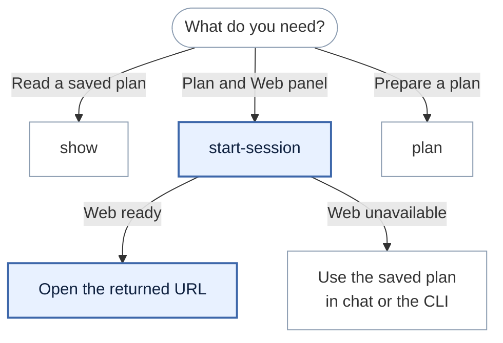

<!-- File purpose: Explain local setup, daily training, scheduling, and project scope. -->

# ai-algorithm-coach

A local algorithm coach with a durable training record.
The Skill handles the conversation. Python handles the rules. SQLite stores the facts.

The local Skill loop needs no database server, model API key, or web service.
The optional local panel uses React with TypeScript and FastAPI. It displays saved
plans, records feedback in the same database, and shows topic completion rates.

[Quick start](#quick-start) · [Training prompts](#customize-training-with-prompts) ·
[Daily scheduling](#schedule-daily-training) ·
[Local Web panel](#run-the-local-web-panel)

## What works

- Create a daily plan from saved records.
- Continue unfinished practice before adding new work.
- Record A–F results, time, and optional details.
- Keep feedback history and accept explicit corrections.
- Retry a submission without counting it twice.
- Derive weak areas and due reviews from recorded evidence.
- Back up the database and check its integrity.
- Package the core with the Skill for use outside this repository.
- Restrict training with dated, versioned scope policies.
- Preview a policy before a host-approved activation.
- Import additional problem metadata without replacing existing entries.
- Save version-bound code and host-model complexity reviews without a model API.
- Read problem history and confirmed learning checkpoints from current records.
- View existing daily plans and save feedback through the optional local Web panel.
- Read independent completion rates by topic and language, with sample counts.

The default language is Java. The default daily plan target is five problems.
Unfinished work uses the same plan capacity. A large backlog can use every slot.
The default profile has no phase system. The optional `tokyo-interview-v1` profile
supports four base slots, one normal supplement, and a justified sixth item.
Language, daily total, timezone, preferred run time, and review rules are configurable.
Scope policies constrain eligibility. They do not replace the learning rules.

## Requirements

- Python 3.12 or later, with `sqlite3` and timezone data.
- A private directory on local disk for a schema version 4 database.
- For chat workflows, a Skill host that can run local commands and read and write that directory.

The terminal commands also work without an agent. With a text-only or remote
client that cannot reach your local workspace, use the CLI or local Web panel for
saved records.

## Quick start

### Set up the workspace

Run the examples from the repository root. Set a private absolute data path
outside the checkout. If you already have a workspace, use the directory that
contains its `coach.sqlite3` and skip `init`. For a new workspace, replace `UTC`
with your training timezone. `plan` saves or reads the first assignment.

```sh
export ALGORITHM_COACH_DATA_DIR="/path/to/private/coach-data"
python3.12 skills/algorithm-coach/scripts/coach.py init --timezone UTC --daily-count 5 --language Java
python3.12 skills/algorithm-coach/scripts/coach.py plan
```

If a command returns `not_initialized`, check the path for your existing store.
Initialize a new workspace only when you intend to create one. On
`schema_mismatch`, use a compatible store. Schema conversion is external maintenance.

The export applies to the current shell and its child processes. For a desktop
agent or scheduled task, set it in that session's tool environment or provide the
absolute data path in the private prompt. Place `--data-dir PATH` before the
subcommand to select the store for one invocation.

### Load the Skill in your agent

Build the full Skill into a new directory for your host. The bundle includes
`SKILL.md`, supporting files, and the Python runtime.

```sh
# Codex
python3.12 scripts/packaging/build_skill.py --output "$PWD/.agents/skills/algorithm-coach"

# Claude Code
python3.12 scripts/packaging/build_skill.py --output "$PWD/.claude/skills/algorithm-coach"
```

Open a local session in this checkout so the agent can use the project Skill.
If the Skill is missing from the menu, refresh it with a new local session.

- **Codex.** Select `algorithm-coach` in the desktop composer or type
  `$algorithm-coach` in the CLI. [Codex Skill setup](https://learn.chatgpt.com/docs/build-skills#where-codex-loads-local-skills)
- **Claude Code.** Type `/algorithm-coach` in the local session.
  [Claude Code Skill setup](https://code.claude.com/docs/en/skills#choose-where-skills-load)
- **Ollama with a local model.** Use the Claude Code bundle above. In the same
  checkout, run `ollama launch claude` and select a local model that supports tool
  calling. Invoke `/algorithm-coach` in the resulting session. Ollama serves the
  model. Claude Code loads the Skill and runs its tools.
  [Ollama and Claude Code](https://docs.ollama.com/integrations/claude-code)
- **Other agents.** Import the complete bundle using your host's Skill loader.
  With local shell access and no Skill loader, ask the agent to read the Skill
  instructions and use the entry script. With plain `ollama run` or a text-only
  client, run the CLI commands locally. [Standalone bundle](#installable-skill-bundle) and
  [Skill instructions](skills/algorithm-coach/SKILL.md)

### Create a daily problem set

After selecting the Skill, you can paste a request like this. Supply the data
path if the host has no configured `ALGORITHM_COACH_DATA_DIR`.

```text
Use the algorithm-coach Skill and my existing workspace at /path/to/private/coach-data.
Use plan to save or load today's problem set in the workspace timezone.
List the problems with their official links.
```

For a browser session, ask it to start today's training and return the local
feedback link. The Skill uses `start-session` for this request. [Web setup](#run-the-local-web-panel)

From the terminal, use `plan` to create or reuse the assignment. Use `show` to
read an existing assignment. Both commands accept `--date YYYY-MM-DD`.



```sh
python3.12 skills/algorithm-coach/scripts/coach.py plan
python3.12 skills/algorithm-coach/scripts/coach.py show
```

The planner uses saved practice, due reviews, and the active scope to select from
the catalog. Running `plan` again for the same date returns the published plan.
The next training date can continue the same unfinished attempt. To limit the
selection or expand the catalog, see [training scope](#set-a-training-scope) and
[problem metadata](#add-problem-metadata).

### Customize training with prompts

Select the Skill in your agent and paste a prompt below. You can edit the
numbers, topics, or problem IDs. Use the existing workspace set up above.

#### Change the daily target and language

```text
Use the algorithm-coach Skill. Set my daily plan target to four problems and
my practice language to Python. Read config first and use its current revision
for the update. Read back the saved target and language.
```

The target includes unfinished work and reviews. New settings apply when a
plan is first saved. The active scope and training profile can limit the result.

#### Choose topics, difficulty, and a daily cap

```text
Use the algorithm-coach Skill. Propose a scope for seven training dates starting
tomorrow in my workspace timezone. Allow Easy problems tagged array or
hash-table. Set a hard cap of three distinct allocations per day across plans
and manual practice. Preview the proposal. Show the scope, hash, dates,
selected candidates, paused work, shortfall, and expiry fallback. Show any
activation blockers. Wait for my approval to activate it.
```

#### Use a hand-picked set of eligible problems

```text
Use the algorithm-coach Skill. For the next training date with no published
plan, propose a one-day scope allowing only leetcode:1, leetcode:20, and
leetcode:704. Preview which problems the planner would select. Show the scope
and hash, plus any inherited limits, paused work, shortfall, or activation
blockers. Wait for my approval to activate it.
```

The ID list defines the eligible pool. The planner uses the saved practice
history and the plan target to select from it. After approving the exact scope
proposal and activating it, ask for a plan inside that date window.
[Policy approval steps](docs/policies.md#proposal-preview-approval-activation)

#### Search online and import new problems

```text
Use the algorithm-coach Skill. Search online for and import up to four new
Medium LeetCode graph problems that use breadth-first search. Use my existing
workspace. Read my catalog, capabilities, and effective training scope first.
Choose problems that are absent from my catalog and fit that scope.

Use your host's web tools to open each official problem page. Check the
problem number, title, difficulty, and canonical link. Map topics to existing
catalog tags. Prepare a batch with only id, title, difficulty, tags, and url.

Preview the exact batch with catalog preview. If import_allowed is true, use
catalog import with the preview payload_hash as --expected-hash and a stable
submission ID. Check the applied receipt and read back the imported entries.
List the added problems with official links. Report any blockers or shortfall.
```

Edit the count, difficulty, and topic to fit your needs. Imported problems enter
the candidate pool for future plans. A host without web access can preview a
metadata file you supply. [Catalog discovery workflow](docs/catalog-discovery.md#use-through-a-host-agent)

### Save feedback

The plan returns stable attempt IDs. Your Skill host uses those IDs internally.
You can then say, for example, "The first problem is D. I spent 20 minutes."
The Skill records the result through the tool and checks its receipt.
You do not need to paste plan data into the conversation each day.

For direct CLI use, replace the synthetic attempt ID below with one from the plan.
Choose one submission ID for this action. Reuse it only when retrying that action.

```sh
python3.12 skills/algorithm-coach/scripts/coach.py feedback \
  --attempt ATTEMPT_ID_FROM_PLAN \
  --submission example-first-feedback \
  --expected-revision 0 \
  --changes '{"result":"D","elapsed_minutes":20}'
python3.12 skills/algorithm-coach/scripts/coach.py state
```

## Schedule daily training

Set the daily trigger in your agent or system scheduler. The stored `run_time`
records the desired local time; it does not start runs. The workspace timezone
determines the training date.

To change the time, save it and compare the host task with it:

```sh
python3.12 skills/algorithm-coach/scripts/coach.py config --changes '{"run_time":"09:00"}' --expected-revision 3
python3.12 skills/algorithm-coach/scripts/coach.py schedule show
python3.12 skills/algorithm-coach/scripts/coach.py schedule check --observed-rrule "FREQ=DAILY;BYHOUR=9;BYMINUTE=0" --observed-timezone Asia/Tokyo
```

Edit the existing scheduled task in place. Do not create a second task. Keep
times and problem counts out of the task prompt; let it follow saved settings.
See [daily mix and run time](skills/algorithm-coach/references/settings.md)
for category slots such as two weak problems and one new problem per day.

### Run the Skill on a schedule

Use a local agent task when the run should include the Skill workflow, such as
processing pending code reviews. Set up the Skill and Web panel once. Use the
same checkout and private data path for manual and scheduled runs.

- **Codex desktop.** In **Scheduled**, create a daily task for this local project.
  Choose the local checkout as the execution environment. Mention
  `$algorithm-coach` in the task prompt. [Codex scheduled tasks](https://learn.chatgpt.com/docs/automations?surface=app)
- **Claude Code Desktop.** In **Code** → **Scheduled**, create a local task for
  this folder. Select **Daily** and set the time. [Claude Code scheduled tasks](https://code.claude.com/docs/en/desktop-scheduled-tasks)

For example, set 08:00 in the scheduler and use these instructions for each run.

```text
Use the algorithm-coach Skill with the existing workspace at /path/to/private/coach-data.
Follow the daily workflow and use start-session for today's training in the workspace timezone.
Return the saved problem set and the exact feedback URL when Web status is ready.
If the panel is unavailable, return the saved plan and the reported reason.
```

Test the prompt once in a local session. Verify that the task can run Python,
read and write the chosen workspace, and start and reach the loopback server.
Keep the computer awake and the desktop app open for local desktop tasks.

### Schedule the CLI directly

Use this path for a scheduled plan with any agent or no agent. On a machine with
`cron` enabled, add these lines with `crontab -e`. Replace the paths with absolute
paths to your interpreter, checkout, and existing workspace.

```cron
COACH_PYTHON="/path/to/bin/python3.12"
COACH_ENTRY="/path/to/ai-algorithm-coach/skills/algorithm-coach/scripts/coach.py"
ALGORITHM_COACH_DATA_DIR="/path/to/private/coach-data"
0 8 * * * "$COACH_PYTHON" "$COACH_ENTRY" plan > "$ALGORITHM_COACH_DATA_DIR/last-scheduled-run.log" 2>&1
```

This triggers at 08:00 in the scheduler's timezone. To prepare the plan and start
the panel on that schedule, complete the Web setup below, set `COACH_PYTHON` to
the absolute path to `.venv-web/bin/python`, and change `plan` to `start-session`.
Read the session URL and status from `last-scheduled-run.log`.

## Run the local Web panel

### Prepare the Web environment

Use Python 3.12 or later and Node.js 24. Run this setup once from the repository
root. Use a browser on the same computer as the service. Managed startup is
available on macOS and Linux.

```sh
python3.12 -m venv .venv-web
.venv-web/bin/python -m pip install -r requirements-web.txt
npm ci --prefix web
npm run build --prefix web
```

To launch from an installed Skill, create `web.toml` in the private data directory
and use absolute paths to the Web interpreter and built UI in this checkout.

```toml
# File purpose: Point an installed Skill to the local Web environment and assets.
[web]
python = "/path/to/ai-algorithm-coach/.venv-web/bin/python"
static_dir = "/path/to/ai-algorithm-coach/web/dist"
```

For a portable Skill with its own UI assets, see [standalone Web bundles](docs/web.md#standalone-web-bundle).

### Start, check, or stop a session

In chat, ask the Skill to start today's training and include the feedback link.
To start from the checkout, use the same private data directory as the Skill.

```sh
.venv-web/bin/python skills/algorithm-coach/scripts/coach.py start-session
```

`start-session` saves or reuses the plan and starts or reuses its Web service.
Open the exact `data.web.url` when `data.web.status` is `ready`. The URL binds the
date and workspace identity. It contains the actual port. If Web startup fails,
use the saved plan and give feedback in chat or the CLI.

Inspect or stop the managed Web service with these commands.

```sh
python3.12 skills/algorithm-coach/scripts/coach.py web status
python3.12 skills/algorithm-coach/scripts/coach.py web stop
```

To open the panel for existing plans, use the service URL from `web status` if
it is ready. To serve the panel without preparing a plan, run the foreground
server below. Open the URL shown in the terminal. Stop the server with Ctrl+C.

```sh
.venv-web/bin/python scripts/serve_web.py --data-dir "$ALGORITHM_COACH_DATA_DIR"
```

### Use the Web panel

The Web panel and Skill use the same SQLite records. The panel reads saved plans.
Create a missing plan with the Skill or CLI, then click **Refresh** in the panel.

| Feature | What it does |
| --- | --- |
| Training record | Browse saved plans by date. Open official problem links and see which attempts have a recorded result. |
| Feedback | Save A–F, cumulative minutes, and optional details such as complexity and where you got stuck. The panel can open the next unanswered problem after saving. |
| Corrections and retries | Use **Correct saved record** to fix a prior entry while preserving its history. A committed receipt confirms a save. **Retry save** reuses the same submission to avoid duplicate writes. |
| Solution editor | Save code and input sizes for a specific feedback revision. See whether the review is pending, reviewed, or stale. The Skill host can analyze pending code in a later session. |
| Practice activity | View daily result counts over four or twelve weeks, with a chart and table. |
| Topic scores | See independent completion rates, sample sizes, and stable-mastery counts by language and topic. Select a topic to inspect its saved problem results. |

Scores use each problem's latest valid A–D result in the selected language.
Each topic's rate is the share of those problems with a self-reported A for
independent AC. See the [Web guide and screenshots](docs/web.md#interface-design)
and [feedback meanings](#feedback-meanings).

## Set a training scope

Policies can restrict topics, difficulties, or specific problem IDs.
They can exclude IDs, prefer topics, and set a shared daily allocation limit.
The unrestricted baseline is revision 0.

Read the current policy and its global `latest_revision` first:

```sh
python3.12 skills/algorithm-coach/scripts/coach.py capabilities
python3.12 skills/algorithm-coach/scripts/coach.py policy get
python3.12 skills/algorithm-coach/scripts/coach.py policy propose \
  --file examples/easy-arrays-policy.toml \
  --expected-revision 0 --submission example-policy-proposal
python3.12 skills/algorithm-coach/scripts/coach.py policy preview --proposal PROPOSAL_ID
```

The example uses `0` only for a workspace with no activated policy.
Use the actual `latest_revision` for every proposal and activation.
The date-effective `revision` can differ from this global concurrency version.

Inspect the exact proposed body, dates, hash, paused work, and fallback behavior.
Activation requires an explicit decision through the trusted host or direct CLI.
After approving that exact proposal, use its hash and the current global version:

```sh
python3.12 skills/algorithm-coach/scripts/coach.py policy activate \
  --proposal PROPOSAL_ID --accept-hash EXACT_PROPOSAL_HASH \
  --expected-revision 0 --submission example-policy-activation
```

Proposing or previewing does not activate a policy or publish a plan.
Omitting `effective_from` uses the next local training date.
Omitted scope fields inherit the policy resolved for that start date.
Omitting `effective_until` removes the end date; it does not inherit one.
An expired policy falls back to a prior applicable policy or the unrestricted
baseline. Preview that transition before approval.

Out-of-scope unfinished work and reviews stay visible as paused work.
Their feedback is unchanged. Feedback for an older attempt can still be recorded.
Published plans stay frozen and report any current policy conflict.
An activation that would conflict with published plans in its effective dates
is refused. Choose the next unpublished date or change the proposal.

`daily_count` limits a generated plan. A policy `max_daily_count` is a hard shared
limit for distinct daily allocations through planning and manual practice.
Without that policy limit, manual practice has no implicit cap from `daily_count`.
See [policy rules and approval](docs/policies.md) for fields and examples.

## Add problem metadata

Inspect a metadata batch before importing it:

```sh
python3.12 skills/algorithm-coach/scripts/coach.py catalog preview \
  --file examples/catalog-extra.toml
python3.12 skills/algorithm-coach/scripts/coach.py catalog import \
  --file examples/catalog-extra.toml --submission example-catalog-import
```

Imports accept curated metadata only: ID, title, difficulty, tags, and an official
LeetCode link. Existing IDs cannot be changed. Exact repeats are safe.
URL validation does not prove that metadata is correct or that a solution is AC.
No remote scraping, full statement, paid content, or practice record is imported.

The preview reports new, identical, and conflicting entries without writing.
Invalid input returns a validation error. A well-formed conflicting batch returns
`import_allowed: false`. Its `payload_hash` is the normalized import identity.
Use `--expected-hash HASH_FROM_PREVIEW` on import to reject changed content.
The guard is optional for existing clients. The write still checks live conflicts.
Confirm the applied receipt and read back `catalog` before reporting success.

For discovery, the host Agent can search official sources and prepare this file.
The Python core has no network fetcher or model API dependency. A recommendation
request does not authorize import. Read the [catalog discovery workflow](docs/catalog-discovery.md)
for source checks, batch authorization, offline input, and Codex Desktop use.
Catalog expansion does not activate a policy or rewrite an already published plan.

## Correct feedback

Read the current revision before making a new change.
A correction is a new immutable revision. It keeps the previous record.

```sh
python3.12 skills/algorithm-coach/scripts/coach.py history --attempt ATTEMPT_ID_FROM_PLAN
python3.12 skills/algorithm-coach/scripts/coach.py feedback \
  --attempt ATTEMPT_ID_FROM_PLAN \
  --submission example-correction \
  --expected-revision 1 \
  --kind correction \
  --changes '{"result":"C"}'
python3.12 skills/algorithm-coach/scripts/coach.py receipt --submission example-correction
```

Do not retry a failed action with a new submission ID until its original receipt
has been checked. A timeout does not prove that a write failed.

## Installable Skill bundle

Build into a new directory. The builder refuses to replace an existing destination.

```sh
python3.12 scripts/packaging/build_skill.py --output /path/to/new/algorithm-coach
```

The output includes `SKILL.md`, the entry script, and the Python core.
It does not need the source checkout at runtime.
Add that folder to a compatible host through its supported Skill mechanism.
This command does not install into any account or global Skill directory.

Configure the same private data directory in that host's tool environment.
If environment variables are unavailable, pass `--data-dir` before the subcommand.
Do not store private records inside the bundle.

## Commands

| Command | Purpose |
| --- | --- |
| `init` | Create the local workspace and save initial settings. |
| `plan` | Ensure that a plan exists for a training date. |
| `show` | Read an existing plan. |
| `start-session` | Prepare a daily plan and start or reuse the local Web service. |
| `web status` / `web stop` | Inspect or stop the managed Web service for this workspace. |
| `feedback` | Append progress or a correction with a submission ID. |
| `history --attempt/--problem` | Read attempt revisions or a problem's practice evidence. |
| `receipt` | Check one submission. |
| `state` | Read weak areas and review state. |
| `config` | Read settings or update them with an expected revision. |
| `practice` | Start an explicit redo or review as a new attempt. |
| `catalog` | Read problem metadata and official links. |
| `catalog preview` | Validate and classify a batch without changing saved state. |
| `catalog import` | Append validated metadata from TOML or JSON. |
| `capabilities` | Read the supported local features and limits. |
| `policy get/history` | Read the effective policy, global version, or revision history. |
| `policy propose/preview/activate` | Prepare, inspect, and explicitly activate a scope policy. |
| `backup` | Write a consistent backup to a new destination. |
| `check` | Check database integrity and references. |
| `rebuild-state` | Rebuild derived learning state from stored records. |
| `review evidence/status/submit` | Save code, inspect pending work, and persist scoped host analysis. |
| `training-context` | Append researched framework, source, and selection context. |

Use `--help` for the exact options. Commands emit structured JSON.
No command sends training records to a remote service.

## Feedback meanings

| Result | Meaning |
| --- | --- |
| A | Reported independent AC, without hints. |
| B | Reported AC after a hint. |
| C | Reported AC after reading an answer. |
| D | Attempted but not yet AC. |
| E | Deferred. It is not complete. |
| F | Skipped for this attempt. It is not complete. |

A–C are user reports. They are not verified judge results.
One A does not mean stable mastery. Review rules use separate attempts on separate
dates. Revisions of one attempt never count as several independent completions.
See [feedback semantics](docs/feedback-semantics.md).

## Test

No third-party test dependency is required.

```sh
python3.12 -m unittest discover -s tests -v
python3.12 scripts/checks/check_comments.py
python3.12 scripts/checks/check_docs.py
```

Tests use synthetic records in temporary directories.
They cover the local feedback loop, repeat submissions, corrections, plan reruns,
review rules, backup recovery, and the standalone Skill bundle.
These tests do not establish compatibility with every AI client or deployment host.

Every PR to `main` runs named syntax, logic, and documentation checks.
See [GitHub Actions and owner review](docs/github-actions.md) for job names,
local commands, repository rules, and the owner-authored PR exception.

## Architecture and next steps

The core is independent of the conversation and transport.
CLI and the optional HTTP API call the same application service.
The SQLite database is the only authority for this local workspace.
Chat summaries and future browser caches are views or pending input.

See the [architecture](docs/architecture.md), [data model](docs/data-model.md),
[policy guide](docs/policies.md), [backup guide](docs/backup-restore.md),
[code reviews](docs/reviews.md),
and [local UI contract](docs/future-ui.md).

The optional React TypeScript forms and FastAPI adapter preserve the same attempt
IDs, feedback revisions, and receipts. The Web panel is local-only. It does not
include accounts, offline queues, plan generation, or policy editing.
Remote Skill access, a running MCP server, cloud authentication, and deployment
are not implemented here.

## Open source boundary

Examples and tests contain synthetic records only.
The catalog stores problem metadata and official links. It does not include full
problem statements, paid material, or any user's chat history.
The runtime handles current-schema records only. Private maintenance tools and
format conversion scripts do not belong in the Skill bundle.

The code uses the [MIT license](LICENSE).
Third-party problem names and linked content remain third-party material.
See [contribution rules](CONTRIBUTING.md) and the [security boundary](SECURITY.md).
External metadata and runtime boundaries are listed in [third-party notices](THIRD_PARTY_NOTICES.md).
