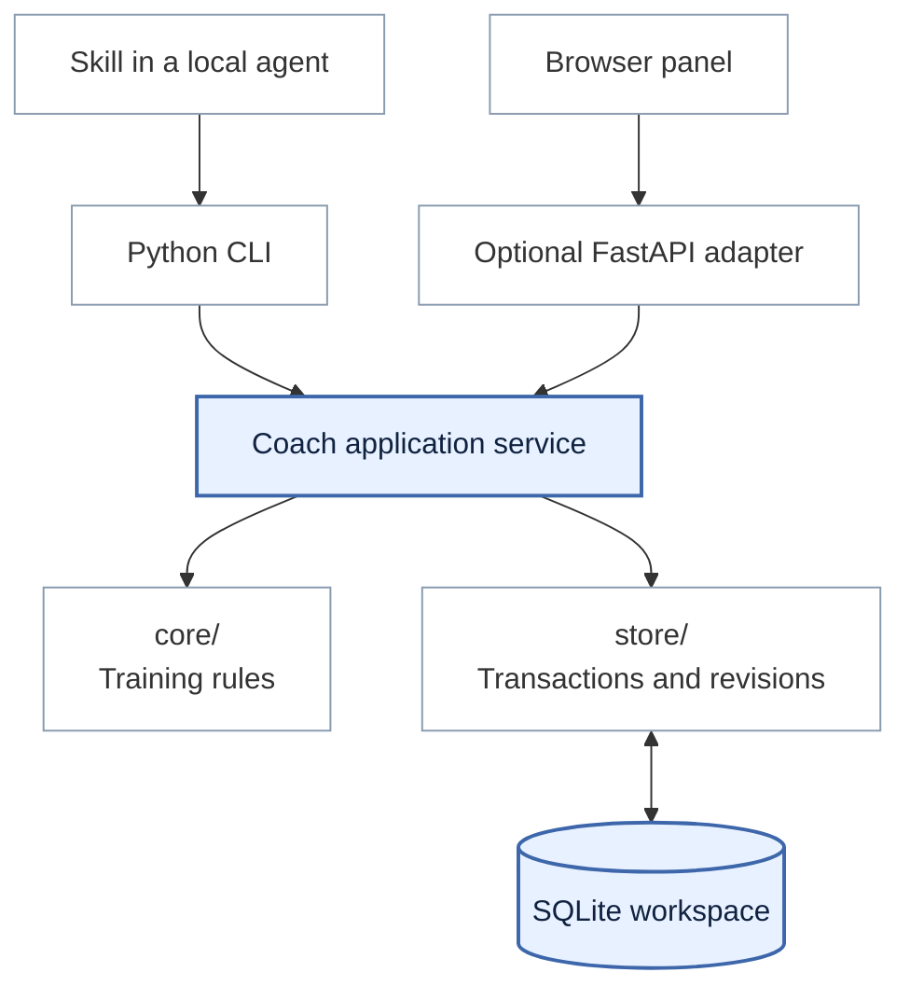

<!-- File purpose: Explain module boundaries, the local data flow, and delivery scope. -->

# Architecture

The optional [local Web panel](web.md) is a thin React and FastAPI adapter.
It reads existing plans and saves feedback through Coach. It does not publish
plans or manage policies. Topic scores are read-only aggregates of current
self-reported evidence. Practice progress is a read-only daily summary from the
same evidence. Neither replaces weakness or mastery rules.

This release is a local tool. A manually requested date uses the records available
when its plan is generated. It does not reconstruct an earlier learning snapshot.
It also does not forecast future results. A dated policy can span a week while
the routine still generates one adaptive daily plan at a time.

## Current delivery

The local Skill loop is the first delivery.
It uses Python 3.12 or later, SQLite, and the standard library.
No dependency installation or long-running service is needed for that loop.



The Skill interprets user intent and explains recommendations.
It does not invent save receipts or keep a competing learning ledger.
The CLI validates its command input and returns structured results.
The application service owns transactions, versions, and idempotency.
Rules choose candidates and derive learning state.
Storage owns schema, consistency checks, and backups.

## Package layout

The package `src/algorithm_coach/` has three subpackages.

```text
algorithm_coach/
  cli.py, service.py, errors.py   Entry point, application service, shared errors
  core/    rules, policies, scoring, training_profile, catalog, catalog_validation
  store/   schema, storage, records, policy_store, complexity
  web/     http_api, identity, runtime, server
```

`core/` holds training decisions. It does not open databases or perform I/O.
`store/` holds the SQLite schema, transactions, and the `Coach` mixins that persist
records. `service.py` combines both layers into one `Coach` service.
`web/` is the optional local adapter. Only this package imports Web dependencies.
The CLI loads `web.runtime` only for interactive session commands.

`store/schema.py` defines the complete current data contract. `store/storage.py`
handles connections and transactions. `store/records.py` reads native practice
context, history, and checkpoints. The learning rules consume these records
without storage-format branches. CLI and HTTP adapters call the same application
service.

## Authority and execution

One database is the authority for one local learning workspace.
It contains saved configuration, plans, attempts, feedback history, and receipts.
Derived state can be rebuilt. Chat context is not a data source.
It also stores immutable policy proposals, activated revisions, exact-hash
approval records, and the append-only imported catalog metadata.

The host Agent may discover public problems using its own network tools.
It prepares metadata; the core validates and previews the batch, then imports it
with existing transactions and receipts when authorized. `remote_fetch` remains
false. Private source reports are supporting evidence, not a second catalog or
learning authority. See [catalog discovery](catalog-discovery.md).

The Skill host must allow tool execution and persistent local storage.
Without those abilities it can provide tutoring, but it must say feedback is not
saved. The bundle carries the same core as the repository. It does not rely on a
second maintained implementation.

## Planning

A training date comes from the configured timezone or an explicit date.
Plans record their configuration and rule context.
Once published, a plan is frozen. Running the command again returns that plan.
It does not change its items or replace feedback.
Plans also pin their policy context. Reads compare that frozen context with the
policy now resolved for the date and report conflicts without rewriting the plan.

Candidates prioritize active unfinished attempts, due reviews, weak areas,
and new coverage. Deferred work returns when its recorded date is due.
Undated deferrals remain visible for explicit rescheduling.
A skipped attempt stops carrying forward and never counts as complete.
Unselected backlog remains pending. It is not silently skipped.

The active scope policy filters every allocation path, including manual practice.
Out-of-scope backlog and reviews are paused with reasons. Their feedback is not
mutated. Old attempts still accept feedback and corrections.
A policy cap is shared by distinct planned and manual allocations for a date.
The ordinary plan target does not silently become a cap on manual practice.

If selection has no candidates, planning returns a blocked result without saving
an empty frozen plan. A partial selection may publish with shortfall reasons.

## Policy lifecycle

Policies constrain eligibility. They are separate from learning rules.
Changes are proposed, previewed without allocations, and activated only after an
explicit trusted-host decision on the exact proposal hash.
The local core can check a hash and record acceptance. It cannot prove that a
human approved a model-generated claim of consent.

Global `latest_revision` provides policy concurrency control.
Date-effective policy revision provides date resolution. They are different values.
Activation advances the global revision; a proposal does not.
Expiry resolves a prior applicable policy or the unrestricted baseline.
See [policy semantics](policies.md) for inheritance, fallback, and approval.

Schema version 4 defines the complete current model. Initialization creates this
schema directly. Opening a different version reports `schema_mismatch` without
changing the store. The Skill and core do not include format conversion tools.

Native practice context supplies identity and framework metadata. Immutable
learning checkpoints retain confirmed state with explicit evidence coverage and
version bindings. Supporting history can exist without an attempt link; it never
creates an extra completion. Derived state reads these current records only.

## Feedback transaction

The service checks a stable submission ID and the expected feedback revision.
It appends a revision, updates derived state, and saves a receipt in one transaction.
A successful response is based on the committed receipt.
A repeated request with the same ID and content gets the original receipt.
The same ID with different content produces a conflict.

This is retryable idempotent processing. It is not an end-to-end exactly-once claim.
There is no separate asynchronous sync worker in the local MVP.

## Adapters

The local UI uses React with TypeScript and a FastAPI adapter.
It calls the same application use cases. See [the UI contract](future-ui.md).
The interactive `start-session` adapter prepares a plan and ensures a local Web
instance. Process discovery, locking, readiness, and shutdown stay outside Coach.
Read [runtime setup](web.md) for the identity and standalone bundle boundary.
A future MCP adapter must also remain thin.
Neither adapter should contain its own selection rules or learning database.

Scheduled execution belongs to an operating system or external platform.
The Skill does not wake itself up. A scheduled deterministic planning command
should work without an active model session. `schedule show` and `schedule check`
describe and compare the saved run time. They do not edit host tasks.

An optional `daily_mix` setting fills ordered category slots in
`core/daily_mix.py`. Without it, both profiles keep their original selectors.

## Explicit limits

The optional Web server binds only to loopback. There is no browser login,
remote API, running MCP transport, scheduler, or cloud deployment in this delivery.
Real AI client compatibility and any future deployment require separate checks.

Host-model review persistence does not add a model API client.
See [code reviews and learning evidence](reviews.md) for the supported workflow.
