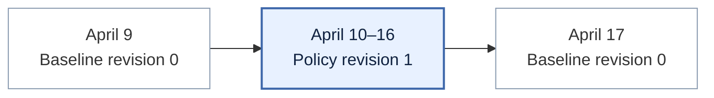

<!-- File purpose: Define dated scope policies, preview, approval, and allocation limits. -->

# Training scope policies

A scope policy decides which problems may be allocated on a training date.
It does not change A–F meanings, weakness evidence, or mastery rules.
The baseline policy is unrestricted and has revision 0.

## Fields

| Field | Meaning |
| --- | --- |
| `name` | A short name for the saved policy. |
| `topics_any` | Allow problems with at least one listed tag. `null` is unrestricted. |
| `difficulties` | Allow listed difficulties. `null` is unrestricted. |
| `problem_ids` | Allow listed catalog IDs. `null` is unrestricted. |
| `excluded_problem_ids` | Always exclude listed IDs. An empty list excludes none. |
| `preferred_topics` | Rank eligible problems with these tags higher. It cannot widen scope. |
| `max_daily_count` | Shared daily allocation cap, or `null` for no policy cap. |
| `effective_from` | First training date on which the policy can apply. |
| `effective_until` | Optional final training date. `null` has no end date. |

Both date boundaries are inclusive. `max_daily_count` accepts integers from 1 to
100 or `null`. Topics and problem IDs must exist in the workspace catalog.
Unknown fields and duplicate list entries are rejected.

`topics_any` uses OR within its tag list. Different allowed dimensions intersect.
For example, array OR string topics with easy difficulty means easy problems with
either tag. Exclusions always win.

Empty allowlists for topics, difficulties, or IDs are invalid.
Use `null` for unrestricted scope. Empty exclusions and preferences are valid.
TOML has no `null` value. Use JSON changes to clear a restriction explicitly.
Omitting a field in a proposal is not the same as clearing it.

## Resolve the base policy

When `effective_from` is omitted, it defaults to the next local training date.
Omitted scope fields inherit the active policy resolved on that proposed start date.
Omitted `effective_until` becomes `null`, even if the inherited policy has an end.
Read the full normalized proposal. Do not infer its contents from the partial input.

When several activated policies apply, the latest applicable activated revision
wins. A future revision does not take effect early.
After expiry, a prior applicable policy can resume. If none applies, the result is
the unrestricted baseline. A proposal preview must expose this fallback.
Use `policy get --date YYYY-MM-DD` to inspect a specific transition date too.

## Versions and concurrency

`policy get` returns `revision` for the policy effective on the requested date.
It also returns `latest_revision`, the highest activated policy revision globally.
Only activation advances this global version. Proposals do not advance it.

Use `latest_revision` for both proposal and activation `--expected-revision` checks.
Do not use the date-effective revision as the concurrency token.

Suppose revision 1 is the only activated policy. It covers April 10–16. Each
lookup below returns `latest_revision: 1`, even after the policy expires.

Config and catalog versions are separate context. A proposal records their versions.
If its context is stale, inspect a new preview and prepare a fresh proposal when
required. Do not bypass a stale check by editing a stored proposal.

## Proposal, preview, approval, activation

1. Read `policy get` and the current `latest_revision`.
2. Use `policy propose` with partial changes and a stable submission ID.
3. Keep the returned `proposal_id`, full body, `content_hash`, and base versions.
4. Use `policy preview --proposal ID` to inspect the proposed result.
5. Check `activation_allowed` and show every `activation_blockers` entry. Show the
   body, dates, hash, eligible count, selections, paused work, shortfall, conflicts,
   and expiry fallback to the user. Resolve blockers before asking for activation.
6. Obtain approval for that exact proposal through the trusted host or direct CLI.
7. Activate with that proposal ID, exact accepted hash, current global version,
   and a new stable submission ID.
8. Check the activation receipt before saying the policy is active.

Proposing saves a proposal. It does not change the active policy.
Preview is read-only. It creates no daily plan or practice attempt.
Activation stores an immutable revision and approval tied to its hash.
A model-generated `user_confirmed` flag is not proof of approval.
See the [host trust boundary](../SECURITY.md).

## Preview results

Preview includes the proposed policy, training date, eligible count, selected
candidates, shortfall, paused backlog, paused reviews, diff, base versions, and
staleness status. `expiry_fallback` shows the resolved policy for the day after a
bounded window ends. It is `null` for a proposal without an end date.
The preview date must be inside the proposed policy window. Use `policy get` to
inspect an outside date. Check the full fallback body, not just its revision.
Candidate previews are not saved assignments and may change before planning.

`activation_allowed` is the activation preflight result.
When it is false, `activation_blockers` contains objects with `code`, `message`,
and `details`. Blockers include a stale proposal, empty eligible scope, conflicting
frozen plans, and an allocation cap below existing manual reservations.
Show the concrete details. Do not ask the user to approve a known blocked change.
An allowed preview does not reserve its context. Activation rechecks all conditions
in its transaction, so a later change can still cause rejection.

A week-long policy defines an eligibility window, not a prediction of future
performance. Generating seven plans now uses records available now and freezes
those assignments. Unfinished attempts may therefore appear throughout that week.
For an adaptive daily routine, activate the window and generate each day when due.
Use previews for future overviews when publication is not requested.

If no candidate can be selected, planning returns a blocked result without freezing
an empty daily plan. If some candidates can be selected, a shorter plan is valid.
The result must explain the shortfall. The core must not fill it with excluded work.

## Existing records and plans

Out-of-scope unfinished attempts and reviews are paused and visible with reasons.
They are not rewritten as E or F and do not become complete.
Later policy changes can make them eligible again.
Feedback for old attempts remains accepted regardless of today's scope.

A published plan keeps its original policy snapshot and items.
Reading it reports whether it matches the policy currently resolved for that date,
and lists conflicts. It is not automatically regenerated.
Activation refuses a policy that would make published plans in its effective dates
violate its constraints. Choose the next unpublished date or change the proposal.
This check uses each plan's saved configuration snapshot. Reducing today's
`daily_count` from five to three does not invalidate an older five-item plan.
A new explicit policy `max_daily_count` can still conflict with those allocations.

## Capacity and manual practice

`daily_count` is the generated plan target and limit.
A non-null policy `max_daily_count` is a shared hard cap across planned and manual
practice allocations for that date. Referencing the same attempt does not create
another distinct allocation. Explicit manual redo or review must pass the scope
and remaining-capacity checks too.

With no policy cap, manual practice is not implicitly limited by `daily_count`.
Scope eligibility still applies. No API or CLI allocation path may bypass it.

## Metadata import

`catalog import` accepts a TOML `problems` array or a JSON object with a `problems`
array. A raw JSON array is rejected. Policy files are plain TOML or JSON objects
whose keys are the policy fields; they do not use a `policy` wrapper.
Each entry has `id`, `title`, `difficulty`, `tags`, and an official LeetCode `url`.
Run `catalog preview --file PATH` first. It reports new and matching entries,
all conflicting IDs, unknown training tags, and the normalized `payload_hash`.
Malformed input returns the existing validation error instead of a partial preview.
The preview does not reserve a version or create a receipt. It writes no records.
Use `catalog import --file PATH --submission ACTION_ID --expected-hash HASH`
to bind the write to the previewed content. Existing callers can omit the guard.
The import is append-only. A matching duplicate is safe; conflicting metadata for
an existing ID is rejected. It never replaces catalog data referenced by feedback.

Accepted URL format is a source constraint, not semantic verification.
Import does not retrieve a full statement or paid content.
Use synthetic examples and public metadata only.
Host networking, source checks, and import authorization are described in
[catalog discovery](catalog-discovery.md). Importing metadata changes the candidate
pool; it does not approve a scope change or force the next plan to select an item.
