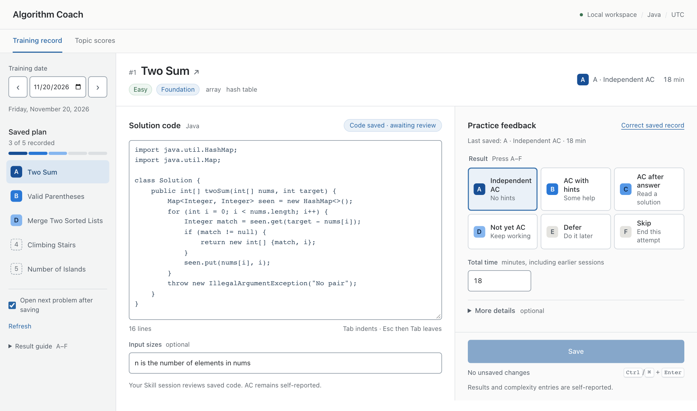
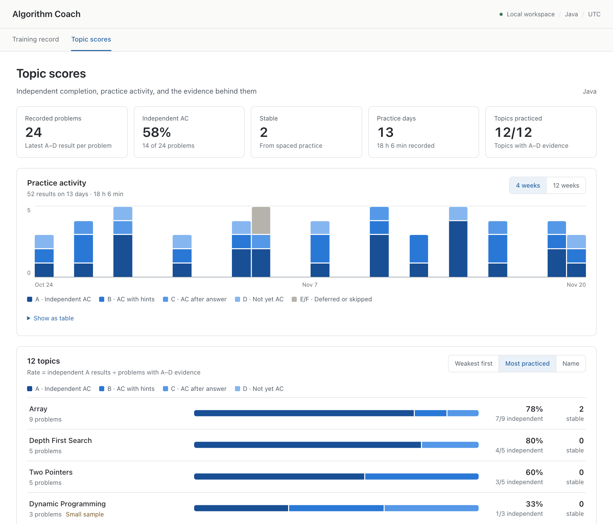

<!-- File purpose: Run and verify the local plan, feedback, and topic-score UI. -->

# Local training panel

The Web panel has two views: daily plans with feedback forms, and topic scores
with practice activity.
React calls FastAPI. FastAPI calls the same Coach service used by the Skill.
SQLite remains the only learning authority.

The code pane saves version-bound solution evidence and displays
pending, reviewed, or stale complexity analysis. It does not launch a model.
The Skill's host session reviews saved code and writes a scoped conclusion through
the shared core. See [code reviews and learning evidence](reviews.md).

## Install and run

Use Python 3.12 or newer and Node.js 24. Run from the repository root.
The Web packages are optional. The standard-library Skill still works without them.

```sh
python3.12 -m venv .venv-web
.venv-web/bin/python -m pip install -r requirements-web.txt
npm ci --prefix web
npm run build --prefix web
```

`web/tsconfig.json` is shared by TypeScript, Vite, and editors. Keep this standard
filename so editors discover the JSX runtime and browser libraries automatically.
TypeScript accepts the purpose comment in this configuration file.
If old editor errors remain, restart its TypeScript service or reopen the project.

Set the same private data directory that your Skill uses. Keep it outside this
checkout. Ask for its path if none is configured. An empty directory without
`coach.sqlite3` is not an initialized workspace. On `not_initialized`, report the
missing database. Do not create or switch stores automatically. A later explicit
request can authorize a new workspace at a confirmed path.

For an authorized new workspace and requested first plan:

```sh
export ALGORITHM_COACH_DATA_DIR="/path/to/private/coach-data"
python3.12 skills/algorithm-coach/scripts/coach.py init --timezone UTC --language Java
python3.12 skills/algorithm-coach/scripts/coach.py plan
```

Choose your real timezone during setup. Existing workspaces should skip `init`.
The panel requires a compatible current-schema workspace. A schema mismatch
leaves the store unchanged. Opening a page never initializes or generates a plan.

`--data-dir` selects one command's store. `init` does not save the path globally.
The export above applies to that shell and its child processes. Another terminal
or host session may need the path supplied again. Do not edit shell profiles or
host configuration unless the user asks. Keep real paths out of shared examples.

Start a training session:

```sh
.venv-web/bin/python skills/algorithm-coach/scripts/coach.py --data-dir "$ALGORITHM_COACH_DATA_DIR" start-session
```

Read `data.plan` for the assignment and `data.web` for the feedback panel.
Open the exact returned `data.web.url` only when its status is `ready`.
The server serves the built UI and API together. Its preferred port is 8765;
another free port is used when needed. The link binds the saved plan date and
store identity. Opening the link never generates another plan.

Repeated sessions reuse a compatible healthy instance for that store. Concurrent
session calls are serialized by a process lock. `plan`, `show`, and `feedback`
keep their existing headless behavior and do not start a service.

```sh
python3.12 skills/algorithm-coach/scripts/coach.py web status
python3.12 skills/algorithm-coach/scripts/coach.py web stop
```

The managed process remains available after the session command exits. Stop uses
a private control credential and the instance identity, not a PID-only signal.
The credential stays in the private runtime directory. It is never part of a
feedback link, browser code, public status result, or diagnostic log.

The manual foreground entry remains available for diagnosis:

```sh
.venv-web/bin/python scripts/serve_web.py --data-dir "$ALGORITHM_COACH_DATA_DIR"
```

This foreground server is not a managed instance. Use its terminal to stop it.

## Request a UI link without a new plan

Check `web status` for the configured store first. If it reports `ready`, use its
actual service URL. This is not a date-bound session link. The command does not
start a service or create a plan. It only tracks
managed instances, including ones previously started by `start-session`.

The CLI has no separate managed start-only command. `start-session` also prepares
a plan, so do not call it merely to open the UI when plan creation is not requested.
For a source checkout, the foreground command above can serve an already built
UI without creating a plan. It needs the Web environment and an active terminal.
It is not included as a script in a standalone Skill bundle and is not managed
by `web status` or `web stop`. Explain that distinction before using this option.

## Private Web settings

Optional settings live in `web.toml` inside the existing private data directory.
They do not change learning rules. For a dedicated Web environment:

```toml
# File purpose: Configure this private workspace's local feedback runtime.
[web]
enabled = true
python = "/path/to/private/coach-data/web-venv/bin/python"
port = 8765
```

The session also accepts `--web-python`, `--web-port`, and `--web-static-dir`
overrides. Use `--no-web` for an explicitly headless interactive session.
Do not install dependencies or rebuild assets during ordinary Skill use.

A ready instance must match the workspace ID, canonical store location, API
version, application version, and verified UI build. Workspace UUID alone is not
enough: a copied database can retain it. The location digest is an identity check,
not an authentication credential. HTTP does not reveal the raw database path.

Runtime information under `.web-runtime` is disposable process state. SQLite is
still the only learning authority. Missing or stale runtime files never justify
initializing another database. A failed Web start leaves the saved plan intact.

## Standalone Web bundle

Build a core-only bundle with the existing builder. To include the local panel:

```sh
npm ci --prefix web
npm run build --prefix web
python3.12 scripts/packaging/build_skill.py --output /path/to/new/web-skill --with-web
```

The builder verifies the complete resource manifest before copying public assets.
It includes the Python requirements file, but no installed environments, Node
dependencies, private data, or local settings. Install the Web Python requirements
once and configure that interpreter. Bundle users do not need Node for daily use.
Core-only bundles keep chat feedback available without the optional packages.

## Plans and records

The default date comes from the saved training timezone. Select another date to
read its existing plan. A missing plan shows an empty state. Generate it through
the Skill or CLI, then reload the view. The panel does not publish plans.

A ready Web service does not mean that the selected date has a plan. With no
saved plan, there are no problem forms to fill in. When the user requests today's
training, run `start-session` with the same data directory. Check its returned
`plan` and `web.status` separately, then share the exact ready feedback URL.
On an already open page, click **Refresh** or reopen that URL to load the plan.
Catalog import alone does not generate an assignment or feedback.

A session link takes precedence over the default date. Invalid dates or store
identities are rejected visibly. The page sends its bound store ID with reads
and writes. If a port later serves another database, the page retains its draft
and refuses to rebase or retry it there. Request a new Skill link for the intended
workspace. The page never silently switches an active attempt after midnight.

Select A–F, enter cumulative minutes, and submit one practice at a time.
Extra fields are optional. Unanswered values are not converted into false or D.
An untouched field stays unchanged. Explicit clearing stays distinct from omission.

One save button records continued progress, details, and code. Its label names
what it will write: **Save feedback**, **Save code**, or **Save feedback and code**.
Use **Correct saved record** when the prior record was wrong. The button then
starts with **Save correction**.
**Cancel correction** restores the saved fields and clears the correction draft.
Both operations keep history and use the current expected revision. There is no
update-mode dropdown.
Save feedback to an existing attempt. Saving never creates a new redo or retest.
Result changes use the current practice time. Corrections and same-result
detail updates retain the saved practice time.

A save waits until the code and review status are loaded for the same feedback
revision as the plan. After a read error, retry the status read. Reload the plan
if the feedback revisions differ.

When both parts are submitted, feedback is saved first. Code is then bound to
the committed feedback revision for a new review. Saving feedback includes
locally edited code or code already saved for the displayed revision. Code from
an older revision needs an explicit choice before it can be bound again.
A rejected code step after committed feedback is reported as a partial save.
Any local code edits stay in the editor.

The page shows unsaved, saving, saved to database, or save failed.
**Retry save** continues from the uncertain step. It checks the same submission
before sending it again and skips a step that already committed.
Only a committed matching receipt confirms a save. A readable HTTP response alone
does not establish success. A lost response can be checked or retried with the
same submission ID and exact content. Conflicts require review and reload.
Requests time out after ten seconds. A timeout leaves the outcome uncertain;
it does not imply that the database rejected the save.

After a save with a result, the page opens the next problem without a result.
Turn this off with **Open next problem after saving** in the rail. The setting
lives only in page memory.

Keyboard shortcuts work while the editor is open. Press A–F to choose a result
when focus is not in a text field. Press Ctrl+Enter or Command+Enter to save or
retry. In the code editor, Tab inserts four spaces. Press Escape, then Tab, to
move focus out of the editor.

Drafts live only in the current page. Switching problems, dates, or views keeps
unsaved fields in memory. Feedback drafts belong to a store, attempt, and saved
revision. Reloading after a conflict clears that revision's feedback draft.
Solution drafts belong to a store and attempt. They keep local edits to the code
or input sizes across panel refreshes. A matching save receipt clears the draft
for the part saved. There is no IndexedDB, offline queue, or background delivery.
A browser reload or tab close discards unsaved input.

## Interface design

These screenshots show synthetic practice records in the local panel.



The panel follows the approved native-tool layout. A gray problem rail sits beside
a white code pane and a quiet feedback pane. Blue marks selection, focus, and the
primary save action. The first saved problem is selected when the plan opens.
Select another problem in the rail to keep working. Only one editor is visible.
Each rail item shows its current result letter. A segmented bar shows how many
problems have a result. Previous-day, next-day, and **Today** buttons sit beside
the date input. **Today** uses the workspace timezone, not the browser clock.
Working text uses 13–16px. Metadata uses at least 12px. Primary controls have a
44px minimum height. Smaller screens stack the panes and reflow problem navigation.

Solution code stays visible. It has no separate disclosure. The code pane grows
to match the feedback pane. Opening an attempt or clicking **Refresh** reads
its latest saved code and review status, including code replaced within the same
feedback revision. Local edits stay visible when a status response arrives.
While a local draft is visible, the review badge identifies the saved version.
The panel marks evidence bound to an older feedback revision as stale.
On wide screens the save bar stays visible at the bottom of the feedback pane.

Native radio controls provide one explicit A–F choice in a three-column grid.
Each card shows its letter, label, and a short detail. No result is selected
for an unanswered attempt. E and F reveal their optional date fields beside the
main inputs. Existing date values remain visible so they can be cleared explicitly.
The result guide is a disclosure at every screen size.

The main form shows only the result, optional dates, and cumulative time.
Complexity, the stuck note, explanation, boundary tests, and familiarity sit under
**More details**. That section opens by itself when any of those fields has a value.

Time and space complexity use native selects. The options
include common complexity classes and an unanswered choice. Existing values outside
the presets remain available exactly as saved. Changing another field does not
normalize or erase them.



The scores view opens with summary tiles: recorded problems, independent AC,
stable problems, practice days, and topics practiced. A daily column chart shows
the last four or twelve weeks. Each column stacks A–D and merged E/F counts.
A table view lists the same days. Each practiced topic has a stacked A–D bar,
its rate, and its stable count. Sort by weakest first, most practiced, or name.
Select a topic to list its problems with their latest result, practice date,
attempt count, and saved mastery. Topics without evidence fold into one line.

Charts use one blue ramp for A–D. Darker means more independent. E/F use gray.
Every chart has a legend and a text or table equivalent, so color is never the
only signal. Charts are plain HTML and CSS. The panel adds no chart dependency.
Missing data stays distinct from zero. Small samples and stable counts keep their
existing meanings.

The design pass follows [unslop](https://github.com/heydamir/unslop) by
Damir Sokolovsky ([@heydamir](https://x.com/heydamir)), licensed under
[CC BY 4.0](https://creativecommons.org/licenses/by/4.0/).
It adapts the spacing, contrast, typography, and interaction guidance to this panel.

## Topic scores

The panel labels scores as independent completion rates based on self-reports.
The score is `100 * A problems / problems with effective A-D evidence`, rounded
to the nearest integer, with halves rounded up.

The calculation uses each distinct problem's latest valid practice result for the
selected language. It first uses the effective feedback revision for each attempt.
Practice time orders evidence. A late correction's receive time does not make an
old practice recent. E, F, and unanswered results add no evidence and do not erase
earlier valid evidence.

Each topic shows its sample size, A–D counts, independent count, and existing
stable-mastery count. No data is shown as no data, not zero. Fewer than five
problems is a small sample. One A does not establish stable mastery.
Multi-tag problems can count in each related topic, once within each topic.
Topic counts must not be added together as a total unique problem count.

Scores are derived on read. They have no separate table and do not change the
existing selection or mastery rules. The metric version is included in the API.

`GET /v1/progress` returns daily activity and per-problem rows from the same core.
Each attempt with a current A–F result counts once on its practice date, with
its recorded minutes. Problem rows reuse the latest A–D rule from topic scores.
The response is read-only and self-reported. It has its own `progress_version`.
Scores and progress load only while the scores view is open.

## Local boundary

This version binds only to loopback. It has no account system or public hosting
profile. Host and Origin checks restrict browser requests. Data paths are fixed
by the server, not accepted from a browser request. Do not expose it on a public
interface or place it behind a public proxy without a separate authentication design.

The local HTTP address does not disable HTTPS certificate checks. This version
does not configure TLS, add an insecure TLS flag, or provide public deployment.
Other processes on the same computer remain within the local trust boundary.

The managed runtime initially supports macOS and Linux. The host must permit
background processes, and the browser must access the same computer's loopback
interface. Host cleanup, logout, sleep, or shutdown can interrupt availability.
The next session checks readiness again. No operating-system supervisor or
all-day uptime guarantee is included. Windows needs a separate lifecycle adapter.

Training data and receipts use `Cache-Control: no-store`. The API does not expose
filesystem paths, credentials, SQL, or a generic command execution endpoint.

## Verify

```sh
.venv-web/bin/python -m unittest discover -s tests -v
python3.12 -S -m unittest discover -s tests -v
npm run typecheck --prefix web
npm run build --prefix web
cd web
npx playwright install chromium
cd ..
npm run check-comments --prefix web
npm run test:e2e --prefix web
python3.12 scripts/checks/check_comments.py
python3.12 scripts/checks/check_docs.py
```

The standard-library run skips optional HTTP tests when their dependencies are
absent. The Web environment must run them. Browser tests verify a real form
submission, the shared feedback and code save, auto-advance, keyboard shortcuts,
date steps, correction history, response-loss and timeout recovery, readback through
the Skill, restart persistence, score charts, topic drill-down, and mobile layout. Screenshots are written
under the ignored `web/test-results` directory. No private workspace is used.
The browser run builds a standalone Web Skill and uses its managed session,
reuse, status, and stop commands. Unit tests cover concurrent startup, stale
runtime state, occupied ports, identity mismatches, and missing Web requirements.

Source files use short English purpose comments and function contracts.
JSON configuration uses legal description fields where supported. The generated
`web/package-lock.json` records exact dependency resolutions; its purpose is
documented here because JSON does not support comment syntax.
